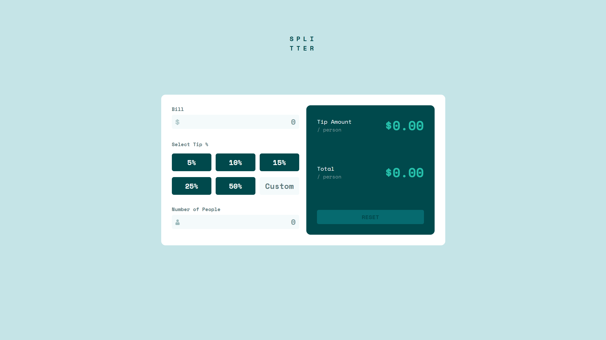

# Frontend Mentor - Tip calculator app solution

This is a solution to the [Tip calculator app challenge on Frontend Mentor](https://www.frontendmentor.io/challenges/tip-calculator-app-ugJNGbJUX). Frontend Mentor challenges help you improve your coding skills by building realistic projects.

## Table of contents

- [Overview](#overview)
  - [The challenge](#the-challenge)
  - [Screenshot](#screenshot)
  - [Links](#links)
- [My process](#my-process)
  - [Built with](#built-with)
  - [What I learned](#what-i-learned)
  - [Continued development](#continued-development)
- [Author](#author)

## Overview

### The challenge

Users should be able to:

- View the optimal layout for the app depending on their device's screen size
- See hover states for all interactive elements on the page
- Calculate the correct tip and total cost of the bill per person

### Screenshot



### Links

- Solution URL: [Add your Frontend Mentor solution URL here](https://www.frontendmentor.io)
- Live Site URL: [Add your live site URL here](https://your-live-site-url.com)

## My process

### Built with

- Semantic HTML5 markup (`<main>`, `<article>`, `<fieldset>`, `<output>`)
- CSS Grid & Flexbox
- Mobile-first workflow
- Vanilla JavaScript (ES6+)
- Regular Expressions (RegEx) for real-time input sanitization

### What I learned

Building this calculator taught me how to handle real-time form validation and edge cases in JavaScript without relying on external libraries. 

Key takeaways from this project include:
- **Sanitizing user inputs with RegEx:** Instead of relying solely on `<input type="number">` (which allows trailing dots or invalid characters in certain browsers), I switched to `type="text"` with `inputmode="decimal"` and chained `.replace()` methods to enforce clean numeric formatting.
- **Synchronizing mutually exclusive inputs:** Managing the state between radio buttons (`5%`–`50%`) and the `Custom` tip input so that selecting one automatically clears or unchecks the other.
- **Handling `NaN` and `Infinity` states:** Ensuring the UI cleanly falls back to `$0.00` when the bill or number of people is empty or zero.

Here is the input sanitization snippet I used for the bill field:

```js
billInput.addEventListener("input", () => {
  billInput.value = billInput.value
    .replace(/[^0-9.]/g, "")          // Keep only digits and decimal points
    .replace(/^\./, "")               // Prevent starting with a decimal point
    .replace(/(\..*?)\..*/g, "\$1");   // Prevent multiple decimal points
  calculateTip();
  errorMessages();
});
```

### Continued development

In future projects, I want to continue refining:
- Form accessibility (`aria-invalid`, associating error messages with inputs via `aria-describedby`).
- Writing modular, reusable validation helper functions to avoid repeating event listener logic across multiple inputs.

## Author

- Frontend Mentor - [@zvko-3dg3](https://www.frontendmentor.io/profile/zvko-3dg3)
- GitHub - [@zvko-3dg3](https://github.com/zvko-3dg3)
